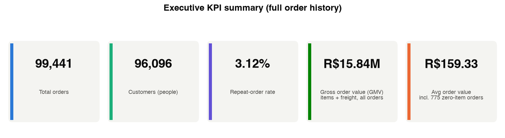
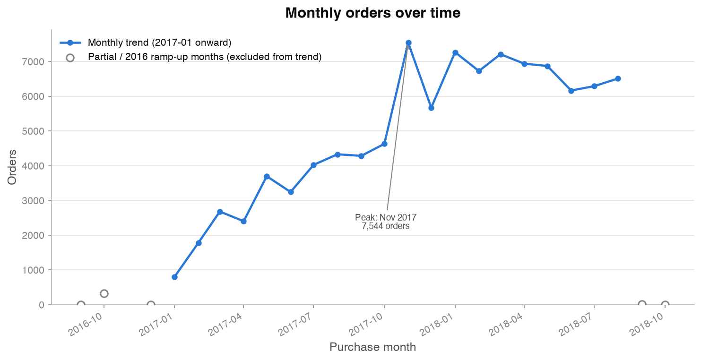
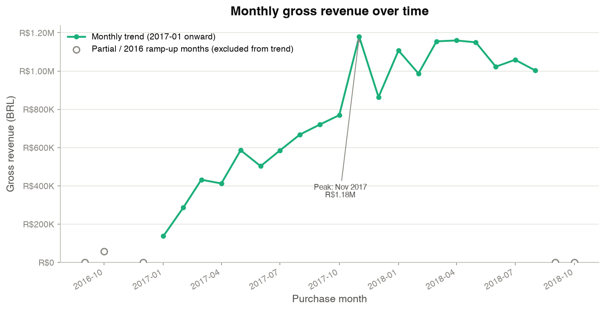
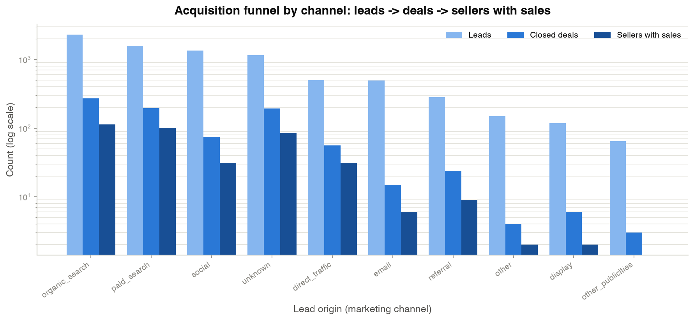
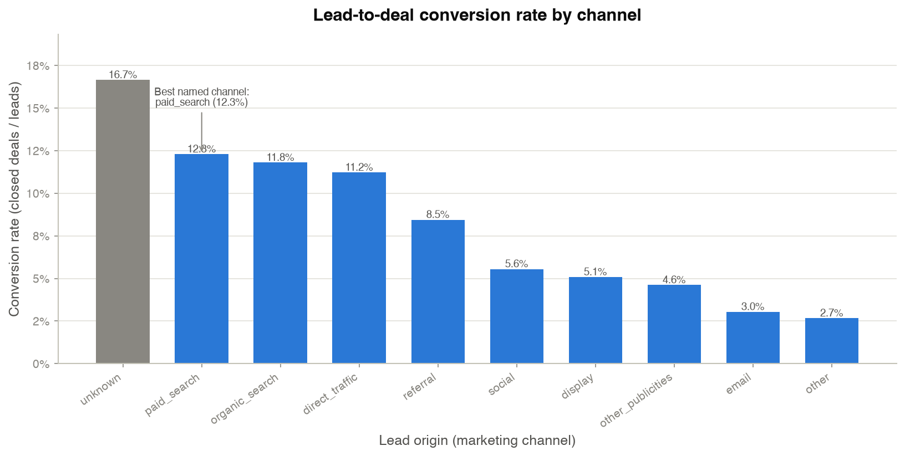
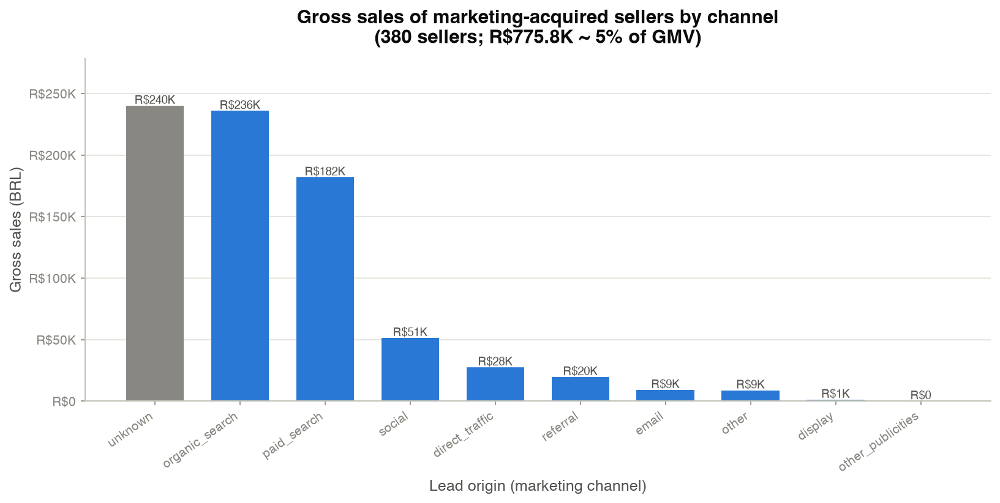
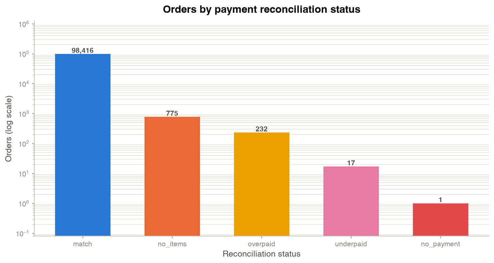
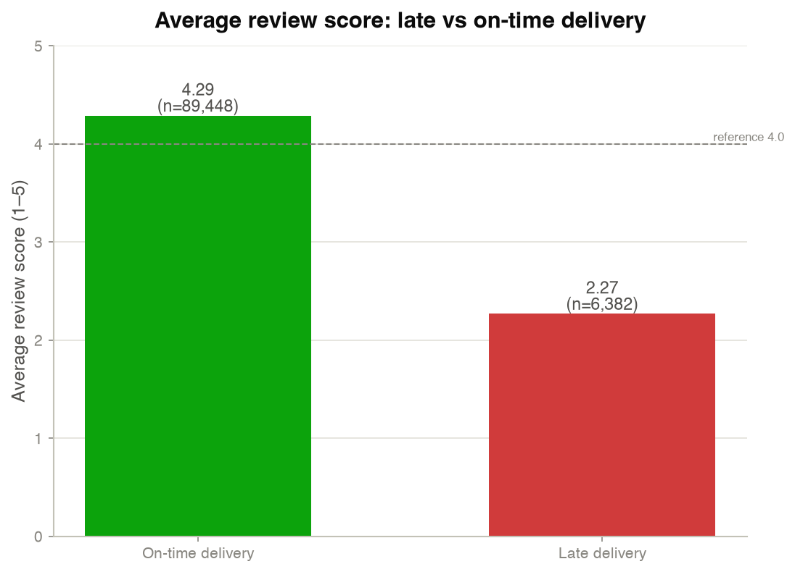
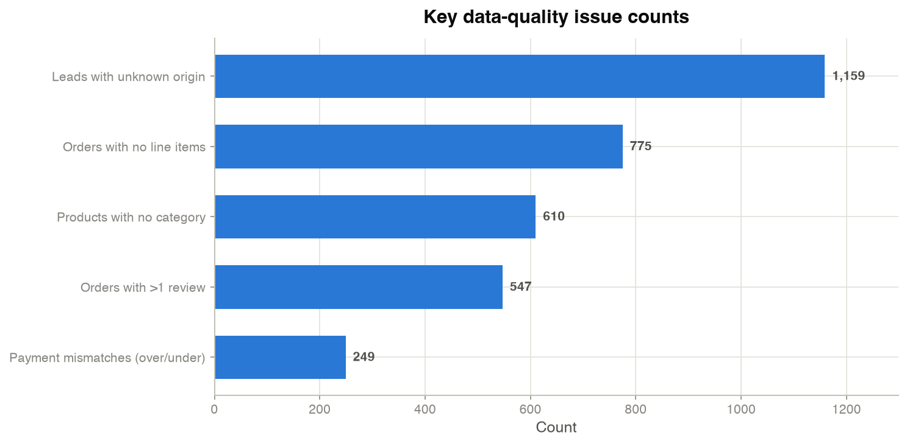

# Multi-Source Data Warehouse (Olist)

Integrate two real Olist source systems, the Brazilian e-commerce platform and
its marketing / sales CRM, into one tested, incremental dbt warehouse. A
business-key integration layer (Data Vault) keeps full change history, and
reporting marts sit on top. Runs locally on DuckDB; the same project is written
to run on Snowflake (see the Snowflake section, which has **not** been executed
yet).

- **Roles:** Data Engineer, Analytics Engineer, BI / Data Analyst.
- **Sources:** `olistbr/brazilian-ecommerce` + `olistbr/marketing-funnel-olist`
  (Kaggle, publisher Olist, license **CC BY-NC-SA 4.0** — non-commercial).
- **Stack actually used:** Python 3.12, pandas, DuckDB 2.0 (duckdb-python 2.0.0),
  dbt-core 1.12.6 + dbt-duckdb 1.9.6, dbt_utils, Git. (`dbt-snowflake` 1.9.4 and
  `snowflake-connector-python` are installed but have **not** been run.)

## Architecture

```
 Two sources            Staging (views)         Integration (Data Vault,         Marts (tables)
 (raw landing)          one per source table    incremental, insert-only)        reporting layer
 ───────────            ────────────────────    ──────────────────────────       ──────────────
 ecommerce (8 files) ─► stg_* (rename/cast/   ─► hubs  (business keys hashed)  ─► dim_customer / dim_seller
 crm (2 files)          trim/normalize/dedupe)   links (relationships)            dim_product / dim_date
                        stg_orders = latest      sats  (change history +          fct_order_items / fct_orders
                        stg_orders_history =       hashdiff)                       mart_seller_acquisition
                          every version                                            mart_monthly_kpis
```

- **Raw landing** (`scripts/load_raw.py`): each CSV lands unchanged plus four
  metadata columns (`_source_system`, `_source_file`, `_loaded_at`, `_row_hash`).
  Loads are idempotent (re-loading identical rows adds nothing) and keep **every
  version** of every row. Two simulated loads: Batch 1 is an as-of snapshot
  (cutoff 2018-01-01), Batch 2 is the full feed, so changed orders arrive as new
  versions like a CDC stream.
- **Incremental + rebuild-identical:** the integration layer is insert-only and
  incremental, and satellites read full history. `scripts/compare_full_refresh.py`
  copies the warehouse after Batch 2, runs `dbt build --full-refresh` on the copy,
  and compares full table contents for every model. Result: **identical, 29/29
  models.** 2,505 orders arrived as new versions between the two batches (2,504 of
  them with a changed status) and the history is preserved.
- **Portability:** all dialect-specific SQL lives in `olist_dbt/macros/portable.sql`
  (`hash_key`, `to_timestamp`, `days_between`, `to_month`, `add_days`), so models
  carry no database-specific functions and the same models run on DuckDB or
  Snowflake.

## Folder layout

```
Multi_Source_Data_Warehouse/
├── config/config.yaml          # paths, batch cutoffs, thresholds, dataset slugs
├── data/raw/                    # untouched Kaggle CSVs (git-ignored)
├── docs/                        # data_sources, data_quality_report, data_dictionary,
│                                #   dashboard_guide, lineage, memo
├── olist_dbt/                   # the dbt project
│   ├── models/{staging,integration,marts}/
│   ├── macros/portable.sql      # cross-dialect SQL
│   ├── tests/                   # singular data tests
│   ├── profiles.yml.example     # `make setup` copies this to olist_dbt/profiles.yml (git-ignored)
│   └── target/                  # dbt artifacts incl. manifest.json / catalog.json (git-ignored)
├── outputs/dashboard/           # CSV extracts for Tableau / Power BI + dashboard.html
├── outputs/charts/              # matplotlib PNGs (see "Dashboard (Python)")
├── scripts/                     # download_data.py, load_raw.py, compare_full_refresh.py,
│                                #   export_dashboard.py, build_charts.py, build_dashboard_html.py
├── tests/                       # pytest for load_raw.py
├── Makefile                     # setup / download / load / build / rebuild-check / test / docs / all
├── requirements.txt             # pinned deps
├── .env.example                 # Snowflake creds template (copy to .env)
└── olist_warehouse.duckdb       # local warehouse (git-ignored)
```

## How to run (DuckDB)

**Prerequisites:** `python3.12`, Git, and the two Kaggle datasets. The raw CSVs
must be placed in `data/raw/` (either via the Kaggle API or a manual download).

**Manual Kaggle download** (if you do not use the Kaggle API token):
1. Download <https://www.kaggle.com/datasets/olistbr/brazilian-ecommerce> and
   <https://www.kaggle.com/datasets/olistbr/marketing-funnel-olist>.
2. Unzip all CSVs into `data/raw/`. (The optional geolocation file is not needed.)
   `scripts/download_data.py` will also print these exact steps if the data is
   missing and no token is found.

**One command, end to end:**
```bash
make all
```
`make all` runs: `setup` → `download` → `load-batch1` → `build` → `load-batch2`
→ `build` → `rebuild-check` → `test` → `docs`. (Note the **two** builds — one
after each batch — so the incremental warehouse accumulates both batches and the
full-refresh rebuild comes out identical.)

**Step by step** (same targets individually):
```bash
make setup          # create .venv (python3.12), install pinned deps, dbt deps
make download       # Kaggle API if a token exists, else catalog what is present
make load-batch1    # python scripts/load_raw.py --batch 1   (as-of snapshot)
make build          # cd olist_dbt && dbt build --target duckdb
make load-batch2    # python scripts/load_raw.py --batch 2   (full CDC feed)
make build          # cd olist_dbt && dbt build --target duckdb  (second build, after batch 2)
make rebuild-check  # python scripts/compare_full_refresh.py (must report identical)
make test           # pytest tests/  +  dbt test --target duckdb
make docs           # cd olist_dbt && dbt docs generate --target duckdb
```

**Export the dashboard CSVs** (after a build; writes to `outputs/dashboard/`):
```bash
.venv/bin/python scripts/export_dashboard.py
```

**Environment note.** The Makefile exports an absolute `DUCKDB_PATH` shared by the
ingestion scripts and dbt, and points `SSL_CERT_FILE` at certifi so build-time
downloads verify TLS. If you run a step outside `make` (e.g. a dbt command or an
ad-hoc query), export these first:
```bash
export DUCKDB_PATH="$PWD/olist_warehouse.duckdb"
export SSL_CERT_FILE="$(.venv/bin/python -m certifi)"
# dbt needs a profile. `make setup` already generated olist_dbt/profiles.yml, so
# point dbt at it when running outside make:
export DBT_PROFILES_DIR="$PWD/olist_dbt"
```

## Dashboard (Python)

Two Python renderers turn the reporting marts into a dashboard with no BI tool
required. Both open the warehouse **read-only** and mirror the three pages of
`docs/dashboard_guide.md`.

- **Static PNGs** — `scripts/build_charts.py` (matplotlib) → `outputs/charts/`.
- **Interactive HTML** — `scripts/build_dashboard_html.py` (Plotly) →
  `outputs/dashboard/dashboard.html`: a single **self-contained** file with
  plotly.js inlined, so it works offline (hover for values, drag to zoom).
  GitHub will not render it inline — download it and open it in a browser.

```bash
.venv/bin/python scripts/build_charts.py          # PNGs  -> outputs/charts/
.venv/bin/python scripts/build_dashboard_html.py  # HTML  -> outputs/dashboard/dashboard.html
# or build both at once:
make charts
```

### Page 1 — Executive KPIs

The KPI "Gross order value (GMV)" is the sum of `total_item_value` (items +
freight) across **all** 99,441 orders — not the marketing-attributed gross on
page 2. The monthly trend runs from 2017-01; the partial boundary months and the
sparse 2016 ramp-up are shown de-emphasized but excluded from the trend line.





### Page 2 — Marketing funnel by channel

"Gross sales by channel" below is the **marketing-attributed** subset only: the
380 marketing-acquired sellers that actually sold (R$775.8K ≈ 5% of total GMV),
not marketplace-wide revenue.





### Page 3 — Data quality & reconciliation





## Key findings (all from the built warehouse)

- **How the systems connect / where keys fail (Q1):** the two systems join on
  `seller_id`. Of 3,557 sellers, 462 exist only in the CRM closed deals and never
  appeared in the store; those same 462 closed deals have 0 order items. Only 380
  of 842 signed sellers ever sold.
- **The real customer (Q2):** `customer_id` is per order, not per person — 99,441
  order codes map to 96,096 people. Repeat rate is **3.12%** (2,997 repeat buyers;
  max 17 orders/person).
- **Acquisition funnel by channel (Q3):** 8,000 leads → 842 closed deals →
  R$775,815.63 gross. `organic_search` has the most volume (2,296 leads, 271
  deals); among paid channels `paid_search` converts best (~12.3%).
- **Incremental / CDC / rebuild (Q4):** 2,505 orders arrived as new versions across
  the two batches (2,504 with a changed status); the full-refresh rebuild is
  **identical (29/29 models)**.
- **Data quality (Q5):** payments reconcile for 98,416 / 99,441 orders (`no_items`
  775, `overpaid` 232, `underpaid` 17, `no_payment` 1). Full detail in
  `docs/data_quality_report.md`.
- **Delivery vs reviews:** 6.77% of delivered orders are late; late orders average a
  2.27 review vs 4.29 on-time. Peak month was Nov 2017 (7,544 orders, ~R$1.18M).
  Partial boundary months 2016-09 / 2018-09 / 2018-10 are flagged.

See `docs/memo.md` for the plain-language write-up and `docs/data_dictionary.md`,
`docs/lineage.md`, and `docs/dashboard_guide.md` for the technical detail.

## Running on Snowflake (Step 10 — NOT yet run)

> **Honesty note:** the project is written and configured to run on Snowflake, but
> this has **not** been executed. No Snowflake run, numbers, or "it works on
> Snowflake" claim is made. The steps below are the exact procedure to run it; any
> SQL failure on Snowflake should be fixed in `macros/portable.sql`, not in the
> models.

1. **Create a free Snowflake trial** at <https://signup.snowflake.com/> and note
   your account identifier.
2. **Create the database and schemas** (in a Snowflake worksheet):
   ```sql
   CREATE DATABASE IF NOT EXISTS OLIST;
   CREATE SCHEMA IF NOT EXISTS OLIST.RAW;
   CREATE SCHEMA IF NOT EXISTS OLIST.ANALYTICS;
   ```
3. **Fill credentials:** copy `.env.example` to `.env` and set `SNOWFLAKE_ACCOUNT`,
   `SNOWFLAKE_USER`, `SNOWFLAKE_PASSWORD`, `SNOWFLAKE_ROLE`, `SNOWFLAKE_WAREHOUSE`,
   `SNOWFLAKE_DATABASE=OLIST`, `SNOWFLAKE_RAW_SCHEMA=RAW`,
   `SNOWFLAKE_ANALYTICS_SCHEMA=ANALYTICS`. Then load them into the environment
   (e.g. `set -a; source .env; set +a`). `.env` is git-ignored — never commit it.
4. **Copy the dbt profile:** copy `olist_dbt/profiles.yml.example` to
   `~/.dbt/profiles.yml` (it reads the same `SNOWFLAKE_*` env vars).
5. **Load and build Batch 1, then Batch 2** (build after each batch so the
   incremental history accumulates exactly as on DuckDB):
   ```bash
   .venv/bin/python scripts/load_raw.py --batch 1 --target snowflake
   cd olist_dbt && dbt build --target snowflake && cd ..
   .venv/bin/python scripts/load_raw.py --batch 2 --target snowflake
   cd olist_dbt && dbt build --target snowflake && cd ..
   ```
6. **Run the rebuild check** to confirm the full-refresh rebuild is identical, as
   on DuckDB (`scripts/compare_full_refresh.py`; point it at the Snowflake target).

Only claim the project runs on Snowflake once these steps have actually completed.

---

See `PROJECT.md` for the full specification, `PLAN.md` for the plan, and
`AI_USE.md` for the AI-use log (bugs found, how caught, anything unverified).
