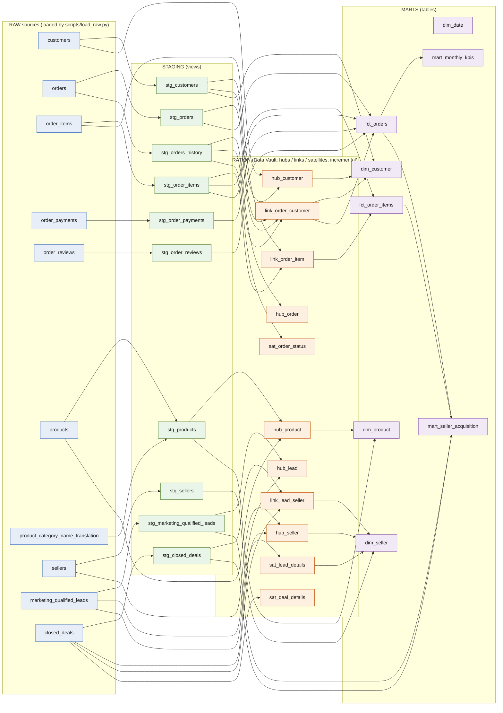

# Data Lineage

**Project:** Multi-Source Data Warehouse (Olist e-commerce + marketing CRM)
**Author:** mishra.sn@northeastern.edu
**Generated from:** `dbt docs generate --target duckdb` (29 models, 10 sources).

## Generating and serving the docs

```bash
# From the repo root, with the dbt env exported (see README "How to run").
cd olist_dbt
dbt docs generate --target duckdb   # writes target/manifest.json + target/catalog.json
dbt docs serve --target duckdb      # serves the interactive lineage graph at http://localhost:8080
```

`dbt docs generate` succeeds and writes three artifacts into
`olist_dbt/target/`:

- `manifest.json` — every model, its config, and its full dependency graph.
- `catalog.json` — the materialized column/type catalog read back from the warehouse.
- `index.html` — the self-contained docs site (`dbt docs serve` hosts this;
  `Ctrl+C` stops the server).

The Mermaid graph below is the same dependency graph, read from `manifest.json`,
grouped by layer. It is accurate to the actual `ref()` / `source()` calls: note
that some hubs, links, and satellites read the **raw source** directly (not only
staging) so they can reconstruct first-seen load timestamps from the full version
history — those edges are drawn too.

## Layered lineage



## Layer summary

| Layer | Models | Materialization | Purpose |
| --- | --- | --- | --- |
| Raw | 10 source tables | tables (loaded by `load_raw.py`) | Untouched landing zone; every row version retained. |
| Staging | 10 `stg_*` | views | Rename, cast, trim, normalize, dedupe. `stg_orders` = latest version; `stg_orders_history` = every landed version. |
| Integration | 5 hubs, 3 links, 3 sats | incremental, insert-only | Data Vault on hashed business keys; satellites keep change history (`sat_order_status` reads full history so a rebuild is identical). |
| Marts | 4 dims, 2 facts, 2 aggregate marts | tables | Conformed reporting layer feeding the dashboards and the memo. |

**Notes on the graph.**
- `dim_date` has no upstream model — it is a generated date spine (`dbt_utils.date_spine`), so it is a standalone node.
- `hub_order`, `link_order_customer`, and `sat_order_status` read `stg_orders_history` (every version) rather than `stg_orders` (latest), which is what makes a full rebuild reproduce the identical status history.
- Hubs/links/satellites that read a raw source directly (e.g. `hub_seller`, `sat_lead_details`, `link_order_item`) do so to establish first-seen load timestamps from the complete version history.
